  

  
  
  

## About me

I'm a **Senior Software Engineer at OptiValue Tek** with **5+ years of
experience** building production web and mobile applications end to end: Angular and React front ends, React Native
mobile apps, Python APIs with Flask and FastAPI, and deployments on AWS. I care about software that is measured, secure
and easy to adopt, and I publish open-source tools for trust & safety.

## Tech stack

  
  
  
  
  
  
  
  

**Also working with:** TypeScript · RxJS · WebSockets · Docker · Kubernetes · Elasticsearch · AWS Cognito · GitHub
Actions · PyTorch · CI/CD

## Experience

| Period | Role | Company | Highlights |
| --- | --- | --- | --- |
| Aug 2025 – now | **Senior Software Engineer** | OptiValue Tek · remote | Large-scale JavaScript application development |
| Jun – Jul 2025 | Senior Software Engineer | InCred Financial Services | Angular, large-scale development |
| Apr 2023 – May 2025 | Software Engineer | Builder.ai | Angular 17 front end; WebSocket and pub-sub real-time communication; real-time charts (Highcharts); Docker and Kubernetes |
| Jul 2021 – Apr 2023 | SDE | Ameha Technologies | Full-stack SaaS ([Siila](https://www.siila.io)): 8 Flask microservices with JWT auth, WebSocket chat, global search, Stripe payments; an education platform with AWS Cognito sign-in and React |
| Feb – Jul 2021 | Software Engineer (intern) | Ameha Technologies | Angular, Flask REST APIs, Elasticsearch, MySQL, AWS |

**Certification:** AWS Certified Solutions Architect – Associate

## Open source

<table>
  <tr>
    <td width="50%" valign="top">
      <h3><a href="https://github.com/karammm/openmoderate-image-moderation">openmoderate</a></h3>
      
Open-source, self-hosted <b>image &amp; video content moderation</b> for Python: an open alternative to AWS
      Rekognition's moderation API.

      <ul>
        <li>CLIP deep-learning model with zero-shot classification and fine-tuning</li>
        <li>82% recall with 4% false positives on a public, hand-reviewed benchmark</li>
        <li>Library, CLI, REST API, Docker, and one-line FastAPI / Flask / Django integration</li>
      </ul>
      

        
        
      

      
<a href="https://karammm.github.io/openmoderate-image-moderation/">Docs</a> ·
         <a href="https://karammm.github.io/openmoderate-image-moderation/benchmarks/">Benchmarks</a> ·
         <a href="https://github.com/karammm/openmoderate-image-moderation">Code</a>

    </td>
    <td width="50%" valign="top">
      <h3><a href="https://github.com/karammm/safetype">SafeType.js</a></h3>
      
Open-source <b>real-time text moderation</b> for any text field or editor: profanity, hate speech and
      harassment, handled as people type.

      <ul>
        <li>Mask, suggest, warn or block, without replacing your editor</li>
        <li>Packages for React, Vue, Angular, plain DOM, and a rich-text editor</li>
        <li>Same rules in Node and Python for server-side enforcement</li>
      </ul>
      

        
        
      

      
<a href="https://karammm.github.io/safetype/docs/">Docs</a> ·
         <a href="https://karammm.github.io/safetype/">Playground</a> ·
         <a href="https://github.com/karammm/safetype">Code</a>

    </td>
  </tr>
</table>

## What I work on

- **Full-stack web applications:** Angular and React single-page apps backed by Python REST APIs.
- **Mobile apps:** cross-platform iOS and Android apps with React Native.
- **APIs and services:** Flask and FastAPI services with authentication, validation and tests.
- **Cloud and delivery:** AWS deployments, Docker, and CI/CD pipelines that release automatically.
- **Trust & safety tooling:** content moderation for text, images and video.

## Let's connect

I'm happy to talk about full-stack engineering, Python APIs, AWS or content moderation. The best way to reach me is
[LinkedIn](https://www.linkedin.com/in/karamjit-verma/) or [email](mailto:karamjitverma89@gmail.com).

The terminal above is a generated SVG: see <a href="scripts/make_terminal.py">scripts/make_terminal.py</a>.
